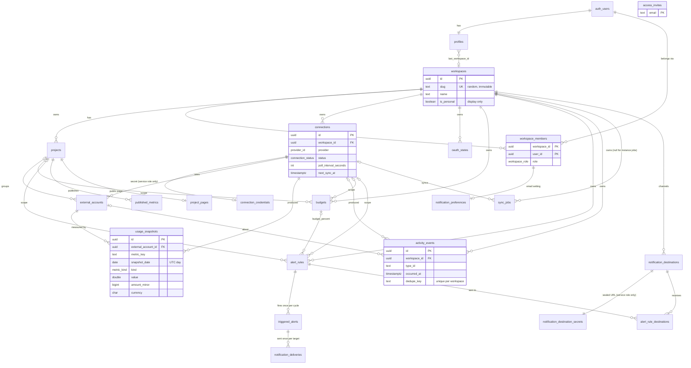

# Database schema

The schema lives in `supabase/migrations/`, forward-only:

| Migration | Contents |
|---|---|
| `20261031090000_tenancy.sql` | Roles, `profiles`, `workspaces`, `workspace_members`, `has_workspace_role`, `create_workspace`, sign-up trigger, last-owner rule, slug immutability |
| `20261031090100_integrations.sql` | `projects`, `connections`, `connection_credentials`, `oauth_states`, `external_accounts` |
| `20261031090200_metrics_events_alerts.sql` | `usage_snapshots`, `activity_events`, `budgets`, `alert_rules`, `triggered_alerts` |
| `20261031090300_jobs_and_invites.sql` | `pg_cron`, `pg_net`, `sync_jobs`, `claim_sync_jobs`, `access_invites`, `hook_before_user_created` |
| `20261031100000_sync_engine.sql` | One open sync per connection, `enqueue_sync_job`, `request_manual_sync`, `enqueue_due_syncs`, `latest_usage_resets`, and the retention purges for snapshots, events, and jobs |
| `20261031100100_oauth_state_pending_installation.sql` | `oauth_states.reconnect_connection_id` and `pending_installation_id` |
| `20261031100200_daily_summary_jobs.sql` | `daily_summary` jobs and `enqueue_daily_summaries` |
| `20261031100300_review_round_one.sql` | Drops `connection_credentials.access_expires_at` and `oauth_states.redirect_after` (never read); adds `purge_oauth_states` |
| `20261104090000_realtime_publication.sql` | Publishes `activity_events`, `usage_snapshots`, `connections`, and `triggered_alerts` to Supabase Realtime |
| `20261105002354_digitalocean_provider.sql` | `provider_id` gains `digitalocean` |
| `20261105002809_provider_posthog.sql` | `provider_id` gains `posthog` |
| `20261105002846_polar_provider.sql` | `provider_id` gains `polar`; `metric_kind` gains `recurring_revenue` for run rates such as MRR and ARR |
| `20261105002847_recurring_revenue_shape.sql` | Recreates `usage_snapshots_value_shape` (recurring revenue is money) and `usage_snapshots_spend_nonnegative` (recurring revenue is never negative, like spend) with the new kind |
| `20261105023129_published_metrics.sql` | `public_metric_id`, `published_metric_rounding`, `published_metrics`, and the publish, unpublish, and public read functions |
| `20261105120000_alert_delivery_job_kinds.sql` | `sync_job_kind` gains `alert_dispatch` and `digest` |
| `20261105120100_alert_delivery.sql` | `notification_preferences`, `notification_destinations`, `notification_destination_secrets`, `alert_rule_destinations`, `notification_deliveries`, and the delivery fields on `triggered_alerts` |
| `20261105120300_provider_sentry.sql` | `provider_id` gains `sentry` |
| `20261105120320_api_keys.sql` | `api_keys`, `api_key_request_windows`, `authenticate_api_key`, `api_key_workspace`, and one `api_*` read function per REST endpoint (#162) |
| `20261105120400_railway_provider.sql` | `provider_id` gains `railway` |
| `20261105120500_project_pages.sql` | `project_pages` and the functions that turn a public project page on and off, find the page an address answers with, and list the sitemap's pages |

`supabase/seed.sql` loads synthetic local data: two invited users, each with a personal workspace, sharing the workspace Acme (one owner, one viewer) with one project, one `fake` connection, three days of snapshots, and a few events. Its header lists the fixed UUIDs tests can use.

## Entity relationships

What each of these is for, and how workspaces, connections, external accounts, and projects fit together: [Workspaces, connections, accounts, and projects](concepts.md).



`access_invites` stands alone: the before-user-created hook reads it to admit an invited email.

References between two tenant rows are composite foreign keys on `(workspace_id, x_id)`, so the database refuses a budget, rule, mapping, or snapshot that points at another workspace's row even if a caller learns its UUID.

## Roles and row level security

Every table in `public` has RLS enabled. Policies call one helper, `public.has_workspace_role(workspace_id, min_role)`, which reads the caller's role from `workspace_members` at query time (never from JWT claims), so a role change applies on the next request. Ranks: viewer 1, admin 2, owner 3.

| Table | Read | Write through the Data API |
|---|---|---|
| `workspaces` | viewer | rename: admin; delete: owner; create: only `create_workspace` (service role) |
| `workspace_members` | viewer | owner manages any row; admin manages non-owner rows; only an owner grants `owner` |
| `projects`, `connections`, `external_accounts`, `budgets`, `alert_rules`, `alert_rule_destinations` | viewer | admin |
| `usage_snapshots`, `activity_events`, `sync_jobs` | viewer | none (service role) |
| `published_metrics`, `project_pages` | viewer | none (service role functions, after an owner or admin check) |
| `triggered_alerts` | viewer | admin acknowledges (`acknowledged_at`, `acknowledged_by` only, in their own name) |
| `notification_preferences` | own row | own row, owner or admin only (viewers receive no alert email) |
| `notification_destinations` | viewer | admin renames, chooses rules and digest, and deletes; created only through `create_notification_destination` (service role); status and errors are server written |
| `profiles` | own row | own row |
| `connection_credentials`, `oauth_states`, `access_invites`, `notification_destination_secrets`, `notification_deliveries` | none | none (service role; the auth hook reads invites) |
| `api_keys` | admin, every column but `token_hash` | admin creates keys and revokes them (`revoked_at` only, final) |
| `api_key_request_windows` | none | none (service role) |

Defense in depth, following BackTalk's hardening:

- Table privileges are revoked from `anon` and `authenticated`, then `authenticated` gets `select` plus only the columns the app writes. Identity, tenancy, provenance, and audit columns are never writable through the Data API. `created_by` and `updated_by` default to `auth.uid()`, and a trigger sets `updated_by` on every signed-in update.
- Every function revokes `execute` from `public` and `anon`; `security definer` functions pin `search_path = ''`, and the authorization helper only ever answers for the caller.
- The database keeps at least one owner per workspace: a deferred constraint trigger on `workspace_members` rejects the commit otherwise. Deleting a user first deletes workspaces where they are the only member; a shared workspace where they are the only owner blocks the deletion until ownership moves.
- `is_personal` is display only. Nothing authorizes on it.

The app mirrors this matrix in one server-side guard (`canPerform`) so users get a clear reason; RLS stays the backstop.

## Workspaces and sign-up

`public.create_workspace(user_id, name, is_personal)` is the only way to create a workspace. It writes the workspace and the owner membership in one transaction. A partial unique index allows one personal workspace per user, and the function returns the existing one on a repeat call, so sign-up is idempotent. The `on_auth_user_created` trigger on `auth.users` creates the profile (display name from GitHub's `user_name`, else `name`) and the personal workspace, and points `profiles.last_workspace_id` at it.

Slugs are 10 random lowercase base32 characters, never derived from the name, and a trigger rejects any change, so renaming never breaks a URL.

## Invite-only sign-up

`public.hook_before_user_created(event jsonb)` returns `{}` when `lower(event.user.email)` is in `access_invites` and a 403 error object otherwise. Supabase Auth calls it for every user creation, including GitHub OAuth and the admin API, so test fixtures add their emails to `access_invites` first, as the seed does. Enable it in `supabase/config.toml` under `[auth.hook.before_user_created]` with `uri = "pg-functions://postgres/public/hook_before_user_created"`.

## Why snapshots double as current metrics

`usage_snapshots` holds one row per external account, metric key, and UTC day. Every sync upserts today's row, so the row for the latest `snapshot_date` per `(external_account_id, metric_key)` is the current value, and earlier rows are the daily history for charts. One table means:

- No second "current metrics" table to keep in step with history, and no window where the dashboard and the chart disagree.
- The unique key `(external_account_id, metric_key, snapshot_date)` makes a sync retry harmless: the last value of the day wins.
- The dashboard reads the newest row with an index scan on that key; the workspace history reads `(workspace_id, snapshot_date desc)`.

Each row keeps the adapter metric model: kind, value and unit or integer minor units and currency (never both), a period or a point in time, provenance, pricing source for estimates, and `retrieved_at`. Totals are only ever computed per currency.

## Jobs

`sync_jobs` is a queue claimed by `claim_sync_jobs(limit, lease_seconds)` with `for update skip locked`, so overlapping ticks never run a job twice. A running job whose lease expired is claimable again until it uses `max_attempts`. `pg_cron` and `pg_net` are installed by migration; the per-minute call to `POST /api/jobs/tick` carries the deployment URL and `CRON_SECRET`, so it is registered per environment, not in a migration.

## Realtime (#129)

The `supabase_realtime` publication holds the sync-written tables the workspace screens read, so an open page updates when a sync writes to them. The screens also read tables that people edit in the app (`external_accounts`, `projects`, `budgets`, `alert_rules`) and `workspace_members`; none of them is published. The Server Function that edits one of those tables calls `refresh()` itself, so the page that made the change reads again. A sync writes only `external_accounts.sync_cursor` among them, which no screen shows, so do not publish them to make a screen live.

| Table | Why it is published |
|---|---|
| `activity_events` | New events on the timeline and the dashboard |
| `usage_snapshots` | Spend, revenue, recurring revenue, usage, and allowances on the dashboard and its trends |
| `connections` | Sync status, last synced time, and errors on the connection pages and the dashboard |
| `triggered_alerts` | The alerts page and the dashboard alerts summary |

`src/components/app/live-refresh.tsx`, mounted once in the workspace layout, opens one channel per workspace for inserts and updates on those tables, filtered by `workspace_id`, and calls `router.refresh()` so the Server Components read again. Refreshes are debounced in `src/lib/realtime/refresh-scheduler.ts`: one 750 ms after the last change, and at least one every 3 s while changes keep arriving, so a sync writing many rows refreshes once or twice rather than per row. A hidden tab refreshes once when it is shown again. No row data is kept in the browser. Realtime checks each change against the subscriber's select policy, the same one the pages use, so a member only hears about their own workspace. The channel is removed when the layout unmounts.

Arriving data is marked so a refresh is visible (#171). `src/components/app/arrivals.tsx` wraps the workspace layout: the components that show data keep what they rendered last time (event ids on the timeline, values by account and metric key on the dashboard, today's trend point) and compare it with the refreshed render, so only what changed is marked; the rules are in `src/lib/realtime/arrivals.ts`. A change is marked only when a batch arrived while the component was in view. A change of path, filters, page, or trend period resets the comparison, and so does leaving a page: with Cache Components, Next.js keeps recent pages mounted but hidden in React `<Activity>` and shows them again on return, so each component registers itself as in view from a layout effect, which hiding cleans up. A first load, a navigation, or a return to a page whose data changed while it was hidden never animates. A new event slides in with a severity-colored edge, a changed card pulses once and shows "Updated", its numbers count from the old value, a usage bar resizes, and today's trend point draws in and pings, all with the landing page keyframes in `src/app/globals.css`, each a second or less, using only properties that do not change layout. Under `prefers-reduced-motion: reduce` each becomes a static highlight that clears after 4 s. One polite live region per workspace says what a refresh brought ("3 new events. Spend in USD updated."). The live indicator in the header reads "Connecting", "Live", or "Offline" (its accessible name always starts "Live updates"), pulses once per batch, and shows the commit time of the newest change on hover and focus.

`connection_credentials`, `oauth_states`, `access_invites`, and `profiles` are never published: `supabase/tests/database/07_realtime_publication.test.sql` pins the exact table list and fails if any of them is added. Replica identity stays the default, because inserts and updates carry the whole new row; only deletes would need `replica identity full`, and the screens do not listen for deletes.

## Public REST API (#162)

The read-only API under `/api/v1` is documented for users in [REST API](../api.md). How it sits on the schema:

- `api_keys` holds one row per key: workspace, name, scopes (`public.api_key_scope`), the SHA-256 hex of the key (`token_hash`, unique), an 8 character display prefix, `created_by`, `last_used_at`, and `revoked_at`/`revoked_by`. The key itself is never stored. Owners and admins manage keys through the Data API; `token_hash` has no select grant, and the `api_keys_guard_revoke` trigger stamps a revoke with the database clock and refuses to undo it. The `api_keys_enforce_limit` trigger refuses a 21st key that is not revoked in a workspace with `program_limit_exceeded` (54000), locking the workspace row so concurrent creates cannot both pass. It skips the count for a signed-in caller who is not an admin of the workspace, so row level security answers them with `insufficient_privilege` (42501) whether or not the workspace is full; the service role is always counted. This follows BackTalk's `api_keys` (its migration 0034).
- `authenticate_api_key(token_hash)` is the one key check: it returns nothing for an unknown hash, `revoked` or `creator_left` for a key that must not work, and otherwise `valid` with the workspace, scopes, and this minute's request count. It counts the request in `api_key_request_windows`, prunes that key's old windows, and refreshes `last_used_at` at most once a minute.
- Each endpoint reads through its own function (`api_workspaces`, `api_projects`, `api_connections`, `api_usage_snapshots`, `api_activity_events`, `api_triggered_alerts`). Every one takes the key hash, not a workspace id, and filters on `api_key_workspace(token_hash, scope)`, so the database itself decides which workspace a key reads and whether its scope allows it. `supabase/tests/database/13_api_keys.test.sql` proves for each function that a key of workspace A reads nothing of workspace B.
- All of these functions are granted to `service_role` only. The route handlers call them with the admin client.

**Reusing the key check (the MCP server, #163).** Do not look keys up again. In a route handler:

```ts
import { authenticateApiRequest, requireApiScope } from "@/lib/api/auth";
import { loadUsageSnapshots } from "@/lib/api/resources";

const { principal } = await authenticateApiRequest(request); // throws ApiError: 401 or 429
requireApiScope(principal, "usage:read"); // throws ApiError: 403
const page = await loadUsageSnapshots(principal.tokenHash, { limit: 50 });
```

`authenticateApiRequest` (`src/lib/api/auth.ts`) reads the bearer key, hashes it, calls `authenticate_api_key`, and enforces the per key rate limit; `apiErrorResponse` in `src/lib/api/errors.ts` turns its `ApiError` into the error envelope with a reference id. The endpoint list with scopes and Zod schemas is `API_ENDPOINTS` in `src/lib/api/endpoints.ts`.

## Retention defaults (#37)

| Data | Kept | Index used by the retention job |
|---|---|---|
| `usage_snapshots` | 13 months by `snapshot_date` | `usage_snapshots_snapshot_date_idx` |
| `activity_events` | 13 months by `occurred_at` | `activity_events_occurred_at_idx` |
| `sync_jobs` | 30 days by `created_at` | `sync_jobs_created_at_idx` |
| `triggered_alerts` | while the rule exists (cascade on rule delete) | not applicable |
| `published_metrics` | while the project exists, revoked rows included (the publication history); rows a deleted user published go with the account | not applicable |
| `project_pages` | while the project exists; turning a page off keeps the row so its address stays reserved | not applicable |
| `oauth_states` | until consumed, or until the retention job finds `expires_at` passed (`purge_oauth_states`) | `oauth_states_expires_at_idx` |
| `api_keys` | while the workspace exists; revoked keys stay listed in settings | not applicable |
| `api_key_request_windows` | the current minute plus five, pruned by `authenticate_api_key` on each request | primary key `(key_id, window_start)` |
| `notification_deliveries` | alert records while their alert exists; digest records 30 days by `delivered_at` (`purge_notification_deliveries`) | `notification_deliveries_digest_delivered_at_idx` |
| `notification_destination_secrets` | while the channel exists; removing a channel deletes it | not applicable |

Nothing is aggregated in the MVP.

## Public metrics (#148)

`published_metrics` records which metrics a workspace has made public, per project. What each metric is and how it is counted is in [Public metrics](public-metrics.md).

- `metric_id` is the enum `public_metric_id`, the only list of publishable metrics; the code keys its definitions by the same enum through the generated types. Spend, budgets, and alert thresholds have no value in it. A row with no `metric_id` is a self-reported value with its own label, value (a whole number), and unit; `published_metrics_source` allows exactly one of the two shapes.
- Rows are never edited except to revoke them (`revoked_at`, `revoked_by`), so the table is also the publication history. Partial unique indexes allow one live row per metric, and per self-reported label ignoring case, in a project.
- Members read it as viewers. Nobody writes through the Data API: `publish_metric`, `publish_self_reported_metric`, `unpublish_metric`, and `unpublish_all_metrics` are service role functions that the Server Actions call after `requireWorkspaceAction(slug, "publish_metrics")`. Each checks the actor's role again (owner or admin, `42501` otherwise) and writes the `devmacro.metric_published`, `devmacro.metric_unpublished`, or `devmacro.metrics_unpublished_all` timeline event in the same transaction.
- `public_published_metrics(project_id)` returns a project's live rows. It is service role only and is the one definition of "currently published" that the public route uses.
- `published_by` cascades on user delete, so deleting an account removes every row its user published. Workspace and project deletes cascade too.
- Not published to Realtime: the page that changes a publication refreshes itself, and the timeline hears the audit event through `activity_events`.

## Project pages (#150)

`project_pages` holds a project's public page, one row per project, created the first time an owner or admin turns the page on. What the page shows is in [Public metrics](public-metrics.md#project-pages).

- Nothing is public by default: a project has no row, and so no page, until someone turns it on. Turning it off sets `enabled = false` and keeps the row, so the slug stays reserved for that project.
- The address is `/@<workspace slug>/<page slug>`. The workspace part is the immutable random slug, and `project_pages_workspace_slug_key` makes the page slug unique within the workspace, so no tenant can take another's old address. `project_pages_slug_format` allows 1 to 40 lowercase letters and numbers with single hyphens between words.
- Members read it as viewers. Nobody writes through the Data API: `save_project_page` (turn on, or change the slug or the indexing choice) and `disable_project_page` are service role functions that the Server Actions call after `requireWorkspaceAction(slug, "publish_metrics")`. Each checks the actor's role again (owner or admin, `42501` otherwise) and writes the `devmacro.project_page_enabled`, `devmacro.project_page_updated`, or `devmacro.project_page_disabled` timeline event in the same transaction.
- `public_project_page(workspace_slug, page_slug)` returns the page an address answers with: on, and with at least one live row in `published_metrics`. An unknown address, a page that is off, and a page with nothing published all return nothing, so the route answers the same 404. `public_project_page_sitemap(limit)` lists the pages that pass the same rule and are `indexable`, newest change first. Both are service role only.
- Workspace and project deletes cascade; `updated_by` is set to null when that user's account is deleted.

## Review against later plans

No planned feature needs a breaking migration:

- **Teams (#105).** The workspace is already the tenant, `workspace_members` already carries `owner`, `admin`, and `viewer`, and every policy already enforces the role matrix, tested for all three roles. Creating more workspaces calls the existing `create_workspace`. Inviting members, changing roles, removing members, and leaving add rows or policies; the last-owner rule already protects ownership transfer. Member lists need a policy that lets co-members read each other's `profiles` row, which is an additive policy. Workspace invites are a new table, separate from the test allow list in `access_invites`.
- **Public REST API.** Built in #162; see [Public REST API](#public-rest-api-162) above. Nothing existing changed shape: the API added its own tables and functions, plus `(workspace_id, created_at, id)` indexes on `projects` and `connections` for its keyset pages.
- **Read-only MCP server (#163).** It reuses the API's keys, scopes, and read functions through `authenticateApiRequest` (see above), so it needs no new tables. Provenance, `retrieved_at`, and estimate flags are stored per row, so tool responses can state where a number came from without new columns.
- **Billing per workspace (#80, #82).** Plan and entitlement columns attach to `workspaces` or a new table keyed by `workspace_id`; nothing is keyed on the user.
